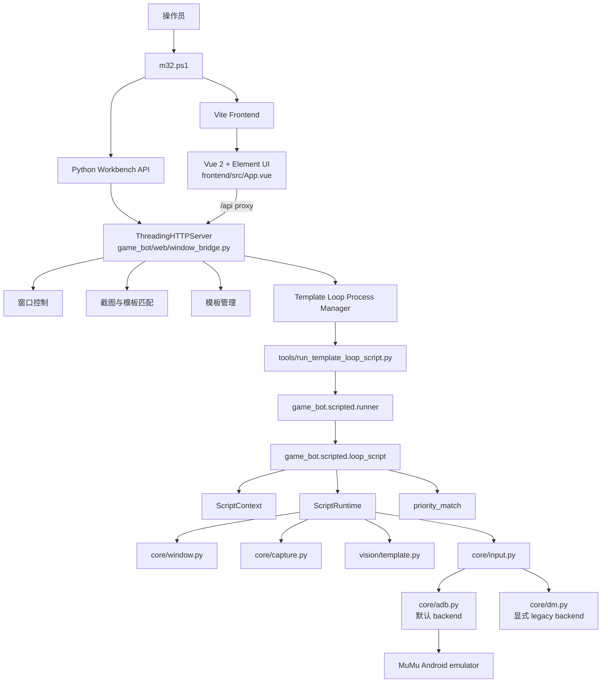

# Monster Job32 当前项目架构

> 本文描述当前工作树中的实际实现，重点覆盖运行边界、主要调用链和模块职责。
> `docs/架构设计.md` 是模板执行器专题文档；本文是全局架构说明。

## 1. 项目定位

Monster Job32 是一个运行在 Windows 上、面向 MuMu Android 模拟器的《魔灵召唤》自动化工具。

系统分为两个边界：

- **Windows 宿主边界**：负责发现和准备模拟器窗口、截取窗口客户区、执行 OpenCV 模板识别，并提供本地工作台。
- **Android 模拟器边界**：负责实际游戏画面和触控输入。默认通过固定 ADB serial 发送点击、滑动和按键。

当前业务自动化方向是：

- Python scripted automation，用于需要明确控制流的业务脚本和可复用组件。
- `state_scripts/*.yaml` template-loop flows，用于模板驱动的重复操作。

旧的 workflow 图式编排仍保留用于兼容和查看历史数据，但不是新玩法的开发方向。

## 2. 总体架构



如果 Markdown 阅读器不支持 Mermaid，可以用下面的调用链理解运行关系：

```text
m32.ps1
  ├─ tools/window_workbench.py --api-only --port 8765
  │    └─ game_bot.web.window_bridge
  └─ corepack yarn dev --port 5173
       └─ frontend/src/App.vue ── /api ──> Python API

state_scripts/<name>.yaml
  └─ TemplateLoopProcessManager
       └─ tools/run_template_loop_script.py
            └─ game_bot.scripted.runner
                 └─ game_bot.scripted.loop_script
                      ├─ ScriptContext / ScriptRuntime
                      ├─ priority_match
                      ├─ core.window / core.capture
                      ├─ vision.template / vision.templates
                      └─ core.input
                           └─ core.adb -> Android emulator
```

## 3. 目录地图

```text
monster-job32/
├─ config/                  全局设置和兼容配置
├─ docs/                    架构、迁移、输入和工作台文档
├─ frontend/                Vue 2 + Vite 工作台
│  └─ src/App.vue           当前工作台主组件
├─ game_bot/
│  ├─ core/                 窗口、截图、ADB、输入和共享模型
│  ├─ vision/               OpenCV 模板匹配和模板文件管理
│  ├─ scripted/             当前自动化执行层
│  │  ├─ components/        可复用业务组件
│  │  ├─ scripts/            Python 脚本扩展点
│  │  ├─ context.py         单次运行上下文
│  │  ├─ runtime.py         脚本动作门面
│  │  ├─ loop_script.py     template-loop 引擎
│  │  ├─ loop_manager.py    template-loop 进程管理
│  │  ├─ priority_match.py  按模板 priority 匹配
│  │  └─ runner.py          统一脚本入口
│  ├─ web/                  本地 HTTP 工作台后端
│  └─ workflow/             legacy workflow 引擎
├─ state_scripts/           template-loop YAML 及流程日志/pause 文件
├─ templates/               PNG 模板和同名 JSON 元数据
│  └─ icons/<group>/
├─ tools/                   CLI、工作台启动器和维护工具
├─ runtime/                 截图、调试图、日志、备份和 PID 产物
├─ m32.ps1                  前后端统一启动脚本
└─ package.json             Vite/Yarn 命令和前端依赖
```

`venv/`、`node_modules/`、`dist/` 等属于本地依赖或构建产物，不是业务源码。
`runtime/` 和部分模板目录可能包含运行过程中生成的文件，应按运行产物处理。

## 4. 启动与进程模型

### 4.1 统一启动

```powershell
.\m32.ps1 start
```

`m32.ps1` 会启动两个独立进程树：

1. Python 工作台后端：

   ```text
   tools/window_workbench.py --api-only --no-browser --port 8765
   ```

   默认地址为 `http://127.0.0.1:8765`。

2. Vue/Vite 开发服务器：

   ```text
   corepack yarn dev
   ```

   默认地址为 `http://127.0.0.1:5173`。前端的 `/api/*` 请求代理到 Python 后端。

PID 文件和服务日志位于 `runtime/m32/`：

- `backend.pid`、`frontend.pid`
- `backend.log`、`frontend.log`
- 启动脚本生成的临时 `.cmd` 文件

### 4.2 管理命令

```powershell
.\m32.ps1 status
.\m32.ps1 stop
.\m32.ps1 restart
```

脚本负责检查 PID、停止进程树、处理过期 PID，并设置 UTF-8 环境变量。也可以绕过统一脚本，分别启动后端和前端，见[常用命令](#13-常用命令与验证)。

### 4.3 后端实现

`tools/window_workbench.py` 是启动器，真正的 API 服务在 `game_bot/web/window_bridge.py`：

- 使用 Python 标准库 `ThreadingHTTPServer`，不是 Flask 或 FastAPI。
- 启动时尝试根据配置寻找并准备游戏窗口。
- 每个工作台实例维护当前 HWND、运行状态和 `TemplateLoopProcessManager`。
- API 同时提供窗口、截图、模板、template-loop 和兼容 workflow 能力。
- 模板、图片和 workflow 路径会限制在项目允许的目录内。

## 5. Vue 工作台与 HTTP API

### 5.1 前端职责

`frontend/src/App.vue` 是当前 Vue 2 + Element UI 工作台的主组件，使用 Vite 开发和构建。当前页面包括：

- 总览：API、窗口、模板和流程状态。
- 模板 / 截图：模板分组、预览、裁剪、元数据编辑和未识别模板清理。
- 状态流程：创建、编辑、启动、暂停、恢复和停止 template-loop flows。
- 流程调度：本地保存的重复、重试、工作日和顺序调度配置。
- 窗口工具：查找、聚焦、置顶、移动、调整尺寸、截图和全屏控制。

前端通常先调用 `/api/bootstrap` 获取 settings、capabilities、templates、template groups、template-loop flows 和启动窗口状态，再按页面调用具体 API。

当前 `App.vue` 仍是较大的单体组件，页面、HTTP 请求、状态和交互逻辑集中在一起。

### 5.2 API 资源分组

`game_bot/web/window_bridge.py` 暴露的接口较多，可按职责理解：

| 资源 | 代表接口 | 职责 |
| --- | --- | --- |
| 服务状态 | `/api/health`、`/api/bootstrap` | 健康检查、能力和初始数据 |
| 窗口 | `/api/window/*` | 查找、聚焦、移动、尺寸、置顶、全屏、光标和屏幕信息 |
| 截图/识别 | `/api/capture`、`/api/template-match`、`/api/group-match` | 截图、模板探测和调试图 |
| 模板 | `/api/templates`、`/api/template-groups`、`/api/template-*` | 分组、创建、复制、重命名、删除、裁剪和元数据 |
| Template loop | `/api/template-loop-flows/*` | 列举、保存、启动、暂停、恢复、停止、日志和失败事件 |
| 调度 | `/api/scheduler-config` | 读取和保存工作台调度配置 |
| Legacy workflow | `/api/workflows/*`、`/api/workflow-runs/*` | 兼容旧 workflow 的查看、校验和运行 |

`/api/workflows` 仍然存在不代表 workflow 是当前主架构；新业务应使用 scripted/template-loop 路径。

## 6. 当前有效的自动化执行层

### 6.1 两种执行形态

| 形态 | 适用场景 | 主要入口 |
| --- | --- | --- |
| Python scripted | 需要条件、循环、恢复、业务抽象等丰富控制流 | `game_bot/scripted/`、`tools/run_scripted_flow.py` |
| Template loop YAML | 由模板状态驱动的重复点击、短动作链和完成计数 | `state_scripts/*.yaml`、`tools/run_template_loop_script.py` |

当前仓库的 `state_scripts/*.yaml` 是活动中的模板循环配置。Python `scripts/` 目录是完整业务脚本的扩展点，具体业务脚本是否已注册和实现，以当前 `runner.py` 与目录内容为准，不应仅根据旧文档假定其已经完整覆盖所有玩法。

### 6.2 Template-loop 调用链

典型调用链为：

```text
state_scripts/<flow>.yaml
  -> TemplateLoopProcessManager.start_flow()
  -> tools/run_template_loop_script.py
  -> game_bot.scripted.runner
  -> game_bot.scripted.loop_script
  -> ScriptContext + ScriptRuntime
  -> priority_match
  -> capture / OpenCV match / input
```

`runner.py` 负责：

- 列出和解析可用的 template-loop 脚本。
- 按 `config/settings.yaml` 中的窗口标题和进程名查找游戏窗口。
- 准备窗口客户区尺寸和自动化状态。
- 提供统一的 `run_script_by_name()` 入口。

`loop_manager.py` 负责工作台启动的后台进程：

- 为每个 flow 创建独立 Python 子进程。
- 读取并泵送 stdout 到 flow 日志。
- 维护 running、paused、completed、failed、stopped 等状态。
- 通过同名 `.pause` 文件暂停/恢复。
- 停止时结束进程树并清理可能遗留的子进程。

### 6.3 单轮模板循环

每轮大致按以下顺序执行：

1. 截取当前游戏窗口客户区。
2. 扫描 `loop_dirs` 对应的 primary 模板。
3. 按模板 `priority` 从高到低分组匹配。
4. 对命中的模板检查 required/excluded 条件。
5. 额外检查 success 和 end 标记模板。
6. 根据结果执行 success、end、普通模板或 fallback 分支。
7. 执行模板 sidecar 中的动作，等待下一轮。
8. 若持续无命中，归档未识别截图，并执行 Esc 或 `start_flows` 恢复。

优先级规则很重要：同一优先级组出现命中后，较低优先级组不再扫描；同组多个命中再按匹配分数等规则选择。因此宽泛模板不应设置过高 priority。

### 6.4 完成、兜底和恢复

- `is_success_template`：成功进度标识。累计成功次数达到 `completion_count` 后结束。
- `is_end_template` 或脚本 `end_template`：立即结束标识。
- `is_fallback_template`：不参与主扫描，仅在整轮没有普通命中时使用。
- `is_non_standalone`：只作为条件或模板链的一部分，不独立触发。
- `post_action_template`：当前动作完成后重新截图，继续匹配并执行后续模板动作；递归深度有限制。
- 连续无命中时，循环会按配置等待并尝试恢复；达到条件后通常先发送 Esc，再执行 `start_flows` 中的恢复 flow。

`start_flows` 在当前实现中主要承担入口/恢复流程引用，不能简单理解为必然在每次 loop 启动前执行的 hook。是否启动前执行由具体调用参数决定。

## 7. 模板与视觉识别

### 7.1 文件布局

```text
templates/icons/<group>/button.png
templates/icons/<group>/button.json
```

PNG 是视觉模板，JSON 是同名 sidecar 元数据。`game_bot/vision/templates.py` 负责模板分组、引用展开、列举、创建、复制、重命名、删除和备份；`game_bot/vision/template.py` 使用 OpenCV 执行匹配。

### 7.2 常用元数据

```json
{
  "priority": 20,
  "threshold": 0.85,
  "actions": [
    {"type": "click_match", "delay_after_ms": 500}
  ],
  "click_region": [0, 0, 120, 60],
  "coordinate_space": "template",
  "postcondition_templates": ["required_state.png"],
  "postcondition_not_templates": ["blocked_state.png"],
  "is_success_template": false,
  "is_end_template": false,
  "is_fallback_template": false,
  "is_non_standalone": false
}
```

实际模板可以使用更多字段，例如 `click_regions`、`group_match_limit`、`post_action_template`、`end_template` 和亮度比过滤相关配置。动作类型由 `loop_script.py` 和 `ScriptRuntime` 共同定义，常见类型包括 click、drag、wait、key、flow、log、pause 和 finish。

### 7.3 坐标空间

模板识别和动作点需要明确区分坐标空间：

- `template`：相对模板左上角，运行时按匹配缩放换算到窗口客户区。
- `window`：Windows 模拟器窗口客户区坐标。
- `screen`：Windows 桌面屏幕坐标，运行时换算为客户区坐标。
- `mixed`：`click_regions` 中每个区域单独声明坐标空间。

`postcondition_templates` 在当前实现中表示同一张截图上的附加命中条件，不是动作完成后的等待条件。

## 8. 窗口、截图与输入边界

### 8.1 窗口管理

`game_bot/core/window.py` 使用 Windows API 完成：

- 按窗口标题或进程名发现窗口。
- 获取窗口矩形和客户区矩形。
- 激活、置顶、移动、停靠和调整客户区尺寸。
- 屏幕坐标与客户区坐标转换。
- 准备自动化所需的窗口状态。

当前 `config/settings.yaml` 的关键设置为：

```yaml
game:
  window_mode: android_emulator
  window_title: Android Device
  process_name: SummonersWar
  window_size:
    width: 1093
    height: 674
```

`window_size` 是 Windows 模拟器客户区目标尺寸，不是 Android 输入分辨率。

### 8.2 截图

`game_bot/core/capture.py` 负责获取客户区图像，当前默认 `capture.backend: auto`：

- 优先使用窗口捕获路径。
- 必要时回退到 Windows GDI 或 mss 等桌面捕获路径。
- 截图、调试图和未识别图像使用 Windows 客户区像素。
- `dm` 截图路径保留为 legacy 能力，按当前项目约束不作为默认路径。

### 8.3 ADB 输入

输入统一从 `game_bot/core/input.py` 进入。默认设置为：

```yaml
input:
  backend: adb
adb:
  executable: D:\Program Files\Netease\MuMuPlayer\nx_main\adb.exe
  serial: emulator-5554
```

边界规则如下：

1. 只有 `game_bot/core/adb.py` 可以直接调用 `adb.exe`。
2. 每条 ADB 命令都必须绑定配置中的明确 serial，禁止隐式选择设备。
3. 脚本和组件只能使用 `ScriptRuntime` 或 `game_bot.core.input`，不能直接调用 ADB shell、COM、SendInput 或 pywinauto。
4. 点击和滑动先读取实时 Windows 客户区尺寸，再映射到 Android active logical viewport。
5. 优先从 `dumpsys input` 解析 active `logicalFrame` 和方向；`wm size` 只用于 fallback，不能直接把物理竖屏尺寸当成游戏逻辑坐标。
6. ADB 支持触摸点击、滑动和按键；右键、dm 特有的按住语义和部分 drag steps 语义不等价时必须明确失败或忽略，不得伪装成完全等价。

映射使用像素中心公式并进行边界裁剪：

```text
adb_x = round((client_x + 0.5) * logical_width / client_width - 0.5)
adb_y = round((client_y + 0.5) * logical_height / client_height - 0.5)
```

如果模拟器客户区出现黑边、letterboxing 或安全区，必须配置显式 viewport，不能硬编码猜测偏移。

### 8.4 dm legacy backend

`game_bot/core/dm.py` 和 `DmInputBackend` 继续保留，用于显式兼容旧环境和诊断。只有配置明确选择 `input.backend: dm` 时才使用；ADB 失败时不应静默切换到 dm。

## 9. 配置与运行时数据

### 9.1 配置

`game_bot/config/loader.py` 统一加载配置并创建运行目录。主要配置文件：

| 文件 | 职责 |
| --- | --- |
| `config/settings.yaml` | 应用、游戏窗口、ADB、截图和 dm backend |
| `config/regions.yaml` | 旧/兼容区域定义 |
| `config/targets.yaml` | 旧/兼容模板目标 |
| `config/states.yaml` | 旧/兼容状态识别定义 |
| `config/actions.yaml` | 旧/兼容动作定义 |
| `config/policy.yaml` | 旧/兼容状态策略 |
| `config/popups.yaml` | 弹窗识别配置，部分旧路径仍会读取 |
| `config/scheduler_config.json` | 工作台默认调度项目 |
| `state_scripts/*.yaml` | 当前 template-loop 业务配置 |

`config/regions.yaml`、`states.yaml`、`actions.yaml` 和 `policy.yaml` 属于仍可加载的兼容配置，不等于当前 template-loop 引擎的主要状态模型。

### 9.2 运行产物

```text
runtime/
├─ m32/                         前后端 PID 和服务日志
├─ screenshots/                 窗口截图
├─ scripts/<run_id>/            单次 scripted 运行上下文、截图和 debug
├─ workflows/<run_id>/          legacy workflow 运行记录
└─ backups/                     模板/配置备份

state_scripts/
├─ <flow>.yaml                  template-loop 配置
├─ <flow>.log                   flow 日志
└─ <flow>.pause                 暂停标记（存在即暂停）
```

未识别画面通常会按 flow 和模板目录归档到相应的 `未识别` 目录，并保留配套 JSON 描述，便于后续制作模板。运行中临时截图和 debug 产物由 `ScriptContext` 管理。

## 10. Legacy 区域与迁移边界

以下内容是兼容保留或历史参考，不应作为新玩法的主扩展方向：

- `game_bot/workflow/*`：旧 workflow 模型、loader、nodes、engine 和 recorder。
- `workflows/*.yaml`：旧图式流程定义。
- `/api/workflows`、`/api/atomic-workflows`、`/api/workflow-runs`：后端仍暴露的兼容接口。
- 旧的 state-script 引擎和相关历史文档：不应复活 `game_bot/scripted/state_script.py`。
- `game_bot/scripted/components/popups.py`：当前是占位实现，不能描述成已经完成的通用弹窗恢复组件。

新增游戏自动化逻辑时：

- 简单模板驱动重复操作使用 `state_scripts/*.yaml`、模板 PNG 和 sidecar JSON。
- 需要丰富控制流时使用 `game_bot/scripted/components/` 和 `game_bot/scripted/scripts/`。
- 输入始终经过 `ScriptRuntime` 或 `game_bot.core.input`。
- 不新增 `workflows/*.yaml` 游戏玩法，不直接扩展 `game_bot/workflow/*`。

现有文档中如果仍出现“dm.dll 为主输入”“workflow 是当前主编排层”等表述，应以本文、`CLAUDE.md` 和 `docs/adb_input_backend.md` 中的当前约束为准。

## 11. 当前架构缺口

以下是当前实现的已知状态，不是已完成能力：

- 尚无正式统一的 test runner、lint、打包配置或应用级 entrypoint。
- `frontend/src/App.vue` 承担过多页面、状态和 API 逻辑。
- `game_bot/web/window_bridge.py` 同时承担路由、状态管理和大量业务处理。
- Active scripted/template-loop API 与 legacy workflow API 并存，概念和前端文案仍有部分混用。
- `game_bot/scripted/scripts/` 是扩展点，业务脚本覆盖情况应以当前注册表和文件为准。
- 通用 popup component 仍是 stub，不能依赖其提供完整恢复能力。
- 部分历史代码和运行日志存在中文编码不一致问题。
- 模板元数据读取失败时部分路径会回退为空配置，可能掩盖 JSON 错误；工作台和启动期校验仍可加强。
- Windows 客户区、Android logical viewport、模板坐标三类坐标空间必须继续保持显式转换，不能由新代码绕过边界。

## 12. 推荐演进方向

1. 先为 `game_bot/core`、`scripted` 和模板元数据解析建立最小自动化测试。
2. 将 `App.vue` 拆为页面组件、API client 和独立状态模块。
3. 将 `window_bridge.py` 的路由、资源服务和运行控制逐步拆分，同时保持本地 API 兼容。
4. 为模板元数据提供启动期校验、错误定位和工作台可视化提示。
5. 完成真正可复用的 popup/navigation 等 scripted components，再扩大 Python 业务脚本覆盖。
6. 对 legacy workflow API 增加明确的 deprecated 标记，并在 active API 稳定后逐步隔离或收敛。
7. 继续把输入坐标映射、截图尺寸和模板元数据视为跨模块契约，避免重新引入隐式坐标假设。

## 13. 常用命令与验证

### 13.1 启动工作台

```powershell
.\m32.ps1 start
.\m32.ps1 status
```

也可以分别启动：

```powershell
& ".\venv\Scripts\python.exe" ".\tools\window_workbench.py" `
  --api-only --no-browser --port 8765

corepack yarn dev
```

构建前端：

```powershell
corepack yarn build
```

### 13.2 列出和 dry-run scripted flows

```powershell
& ".\venv\Scripts\python.exe" ".\tools\run_scripted_flow.py" --list
& ".\venv\Scripts\python.exe" ".\tools\run_scripted_flow.py" judgment_dungeon --dry-run
```

直接运行 template-loop：

```powershell
& ".\venv\Scripts\python.exe" ".\tools\run_template_loop_script.py" ".\state_scripts\世界BOSS.yaml" --dry-run
```

### 13.3 API 健康检查

```powershell
Invoke-WebRequest http://127.0.0.1:8765/api/health
Invoke-WebRequest http://127.0.0.1:8765/api/bootstrap
```

### 13.4 ADB 排障

```powershell
& "D:\Program Files\Netease\MuMuPlayer\nx_main\adb.exe" `
  -s "emulator-5554" devices -l

& "D:\Program Files\Netease\MuMuPlayer\nx_main\adb.exe" `
  -s "emulator-5554" shell wm size

& "D:\Program Files\Netease\MuMuPlayer\nx_main\adb.exe" `
  -s "emulator-5554" shell dumpsys input
```

不要仅凭 `wm size` 的物理竖屏输出推导点击坐标；输入映射必须使用 active logical display frame。

## 14. 相关文档

- [模板执行器与 loop_template 架构设计](架构设计.md)
- [ADB 输入后端](adb_input_backend.md)
- [Python 脚本化自动化迁移说明](scripted_automation_migration.md)
- [Vue 工作台开发启动](vue_workbench.md)
- [模块索引](模块索引.md)
- [CLAUDE.md](../CLAUDE.md)
